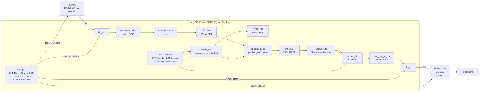

# Project Auris

**FPGA-Accelerated Assistive Audio Platform**

[](https://github.com/<OWNER>/project-auris/actions/workflows/ci.yml)
[](https://github.com/<OWNER>/project-auris/tree/main/docs)
[](./LICENSE)
[](https://github.com/<OWNER>/project-auris/releases)

Project Auris is an open-source FPGA-only hearing-assistive platform
built around a Xilinx Spartan-7 FPGA (Arty S7-25) that performs
real-time spectral audio processing in a wearable form factor. An
INMP441 MEMS microphone feeds a 256-point FFT pipeline running on the
FPGA, which applies user-configurable per-bin gain and calibrated noise
gating before reconstruction and playback through a
PCM5102A DAC. The FPGA is the sole control plane — onboard push
buttons drive mode selection and volume, the RGB LED indicates the
active mode, and four named listening profiles (*General*, *Speech*,
*Music*, *Hearing*) ship as pre-computed gain tables inside the
bitstream.

---

## Architecture Overview

The system is a single FPGA plus two audio codecs — there is **no
external microcontroller, no host processor, and no firmware to
flash**. The **Arty S7-25** performs all signal processing **and** all
control: it generates the I2S clocks (BCLK and LRCLK), drives the
user interface from the four onboard push buttons, loads the
selected mode's pre-computed per-bin gain table, and processes audio
through a 256-point overlap-add FFT pipeline with per-bin gain and
gating. In the current FPGA-only build, each mode also applies
distinct scalar controls (master gain, gate ratio, base noise floor),
and an adaptive ambient tracker raises the effective noise floor in
noisy conditions.



The signal flow on the FPGA is
`I2S_RX -> CDC -> Hann window -> FFT-256 -> spectral_proc (gain + gate) -> IFFT-256 -> 50% overlap-add -> volume -> CDC -> I2S_TX`.
The spectral processor reads its per-bin gain coefficients from a
dual-port BRAM that `mode_ctrl` populates from the pre-computed tables
shipped inside the bitstream; mode changes are triggered by BTN0/BTN1
and committed atomically to avoid audible artefacts. Mode-specific
scalar defaults are applied in the same control path, and a lightweight
adaptive noise-floor tracker in `top.sv` feeds the DSP gate threshold.
Elastic AXI-stream buffers protect both XFFT inputs from short realtime
`TREADY` stalls; a focused 4 ms XFFT handshake regression checks that
neither buffer overflows.

---

## Quick Start

### Prerequisites

- **Vivado 2024.1 or newer** — the WebPack / free edition is sufficient for
  the XC7S25 device on the Arty S7-25
- **Python 3.9 or newer** for the coefficient generators
- **Git** for version control
- A **Digilent Arty S7-25** board, a micro-USB cable for it, an
  **INMP441** I2S microphone and a **PCM5102A** I2S DAC on a breadboard,
  and wired headphones for verification

### Build

The repository ships with a top-level Makefile that orchestrates the
FPGA build and simulation flow. Run them in order:

```bash
# 1. Clone the repository
git clone https://github.com/<OWNER>/project-auris.git
cd project-auris

# 2. Generate the Hann window and per-mode gain tables
make tools

# 3. Build the FPGA bitstream (outputs to fpga/vivado_proj/...)
make fpga
```

### FPGA-Only Self-Test (No Mic / No DAC)

If you only have the Arty S7-25 board and USB cable, use the built-in
self-test path:

```bash
# Top-level self-test simulation (includes JA7->JA6 digital loopback emulation)
make fpga-sim-selftest

# Build a self-test bitstream (internal deterministic stimulus + loopback checker)
make fpga-selftest

# Focused XFFT backpressure check (shorter than the full audio simulation)
vivado -mode batch -source fpga/scripts/sim_xfft_handshake.tcl
```

Board procedure for no-codec bring-up:

1. Place one jumper wire from JA7 (I2S DAC data out) to JA6 (I2S ADC data in).
2. Program the self-test bitstream.
3. Observe RGB LED status:
  - blinking yellow: checker warming up / accumulating evidence
  - cyan: sustained loopback pass
  - red: loopback mismatch detected
4. STATUS2 (clip/error LED) also latches high on loopback mismatch.

### Flash and Run

```bash
# Program the FPGA via Vivado Hardware Manager, or use openFPGALoader:
openFPGALoader -b arty_s7 fpga/vivado_proj/auris.runs/impl_1/top.bit
```

For day-to-day FPGA work, `vivado fpga/vivado_proj/auris.xpr`
opens the GUI for interactive debug, waveform inspection, and
floorplanning. See [`docs/IMPLEMENTATION_PLAN.md`](docs/IMPLEMENTATION_PLAN.md)
for the full list of build and simulation targets.

The Arty S7-25 is configured for quad-SPI flash boot, so a single
Vivado `program_flash` will persist the bitstream across power
cycles — no firmware to flash, no second microcontroller to keep in
sync.

---

## Repository Structure

| Path        | Purpose                                                                  | Key contents                                                                                                                              |
|-------------|--------------------------------------------------------------------------|-------------------------------------------------------------------------------------------------------------------------------------------|
| `fpga/`     | SystemVerilog RTL, testbenches, constraints, IP, and build scripts        | `rtl/`, `sim/`, `constraints/`, `ip/`, `scripts/`, `generated/`                                                                          |
| `tools/`    | Python code generators (window, gain tables, latency, validation)         | `win_gen/`, `profile_gen/`, `fft_gen/`, `latency_analysis/`, `validation/`, `freq_resp_gen/`, `test_vector_gen/` |
| `hardware/` | Schematics, bill of materials, mechanical and wiring notes                | `schematics/`, `bom/`, `mechanical/`                                                                                                      |
| `docs/`     | Architecture, phase reports, college-application portfolio material      | `fpga_only_architecture.md`, `migration_summary.md`, `documentation_audit.md`, `architecture/`, `hardware/`, `phase_reports/`, `college_app/`, `DEMO_PLAN.md`, `IMPLEMENTATION_PLAN.md` (historical) |
| `archive/`  | Pre-migration ESP32 + FPGA build source (historical)                     | `firmware/` (canonical archive), `rtl/` (spi_slave, reg_file, cdc_spi_*), `tb/` (tb_spi_slave, tb_reg_file)                              |
| `firmware/` | HISTORICAL — duplicate of `archive/firmware/`; retained per migration brief; not part of the build | Same content as `archive/firmware/`                                                                                       |

See [`docs/fpga_only_architecture.md`](docs/fpga_only_architecture.md) for
the canonical architecture overview. The pre-migration
implementation plan at
[`docs/IMPLEMENTATION_PLAN.md`](docs/IMPLEMENTATION_PLAN.md) is retained
as a historical record (banner-added 2026-08-12).

---

## Hardware

Arty S7-25 (XC7S25) FPGA + INMP441 I2S MEMS microphone + PCM5102A I2S
DAC + wired headphones, wired point-to-point on a breadboard. The
FPGA generates BCLK and LRCLK on-board; no external clock source or
microcontroller is needed. Pin assignments, timing constraints, and
the I2S wiring diagram live in
[`docs/hardware/WIRING.md`](docs/hardware/WIRING.md); the canonical
bill of materials with part numbers, suppliers, and per-line cost is
in [`hardware/bom/bom.csv`](hardware/bom/bom.csv).

---

## Documentation

| Document                                              | Purpose                                                                       |
|-------------------------------------------------------|-------------------------------------------------------------------------------|
| [`docs/fpga_only_architecture.md`](docs/fpga_only_architecture.md) | Canonical architecture overview for the FPGA-only build |
| [`docs/migration_summary.md`](docs/migration_summary.md) | Narrative of what changed on 2026-08-12 (ESP32 → FPGA-only) |
| [`docs/IMPLEMENTATION_PLAN.md`](docs/IMPLEMENTATION_PLAN.md) | HISTORICAL — pre-migration implementation plan (banner-added 2026-08-12) |
| [`docs/architecture/`](docs/architecture/)            | Block diagrams, clock-domain analysis, DSP pipeline, modes & gains, resource budget |
| [`docs/hardware/`](docs/hardware/)                    | Pin maps, wiring diagram, BOM, mechanical notes                              |
| [`docs/phase_reports/`](docs/phase_reports/)          | End-of-phase reflections and lessons learned                                  |
| [`docs/college_app/`](docs/college_app/)              | Essay topics, demo script, technical report, portfolio framing                |

---

## Project Status

The FPGA-only architecture is implemented at the RTL source level. The
core repair pass has addressed I2S framing, stereo routing, fixed-point
gain handling, mode-commit atomicity, and XFFT configuration handshakes;
fresh simulation and implementation reports are still required before
claiming full end-to-end verification. The migration from the pre-migration ESP32 + FPGA
build is documented in
[`docs/migration_summary.md`](docs/migration_summary.md) (narrative)
and [`docs/fpga_only_migration_forensic_audit_2026-08-12.md`](docs/fpga_only_migration_forensic_audit_2026-08-12.md)
(forensic audit).

| Subsystem                       | Status                                |
|---------------------------------|---------------------------------------|
| FPGA toolchain (Vivado)          | ✅ Verified — bitstream synthesises, MMCM locks |
| `clk_gen` (12 MHz → 96 MHz DSP + frac BCLK + LRCLK) | ✅ Implemented |
| I²S master mode (FPGA drives BCLK/LRCLK) | ✅ Implemented |
| `i2s_rx` (24-bit slave receiver)   | ✅ Implemented; framing regression updated |
| `i2s_tx` (24-bit slave transmitter) | ✅ Implemented; hardware timing validation pending |
| CDC FIFOs (i2s↔dsp, both directions, ×2 L/R) | ✅ Implemented, testbench passes |
| 256-pt FFT pipeline (input buf → Hann → FFT → spectral proc → IFFT → OLA → volume → output buf) | ✅ Implemented; XFFT handshake check passes |
| Mode switching (BTN0/BTN1, 4 pre-computed gain tables + per-mode scalar controls) | ✅ Implemented |
| Volume control (BTN2/BTN3, 31 levels, sat24) | ✅ Implemented |
| LED indicators (STATUS0 heartbeat, STATUS2 clip, RGB mode colour) | ✅ Implemented |
| Bypass mode (`dsp_enable_i = 0`) | ✅ Implemented |
| Verification infrastructure (xsim, lint, MD formatting) | ✅ CI gating on simulation |
| DRC, WDRC, feedback canceller     | ⬜ Planned (Phase 4+) |
| Custom PCB and 3D-printed enclosure | ⬜ Planned (Phase 5) |

---

## Contributing

Contributions are welcome. Please read
[`CONTRIBUTING.md`](CONTRIBUTING.md) for the developer workflow, the
Developer Certificate of Origin (DCO) sign-off procedure, the branch and
naming conventions, and the area ownership table before opening a pull
request.

---

## License

Project Auris is released under the [MIT License](LICENSE).

---

## Acknowledgments

This project builds on the work of many upstream communities and vendors:

- **Digilent** — for the Arty S7-25 board, the XC7S25 reference designs,
  and the open documentation that makes low-cost FPGA prototyping
  possible
- **InvenSense / TDK** — for the INMP441 I2S MEMS microphone and its
  application notes
- **Texas Instruments** — for the PCM5102A I2S DAC and its evaluation
  documentation
- **Xilinx / AMD** — for Vivado and the XFFT IP core that powers the
  256-point FFT pipeline
