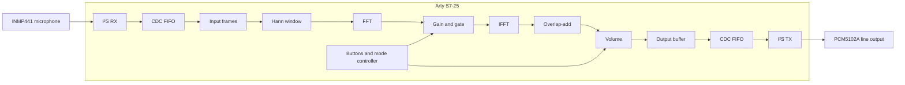

# Project Auris

An FPGA audio-processing prototype exploring frequency-dependent sound shaping. Auris is a solo project led by Sohan
Kumar to study digital hardware and signal processing through an assistive-audio application.

## At a glance

| Platform | Implementation |
| --- | --- |
| FPGA | Digilent Arty S7-25 Rev. E, Spartan-7 XC7S25 |
| Language | SystemVerilog, with Tcl build scripts and Python analysis tools |
| Audio | Intended 48 kHz, 24-bit I²S input/output; mono DSP duplicated to both outputs |
| Processing | 256-point FFT/IFFT vendor IP, periodic Hann window, frequency-dependent gain, threshold attenuation, overlap-add |
| Controls | Four onboard buttons for profile and volume; RGB/status LEDs |

## Motivation

Continuous audio requires ordered samples, consistent arithmetic, and processing that keeps pace. An FPGA makes these
requirements explicit through concurrent logic, clock boundaries, and physical timing. Auris connects these challenges
to digital hardware and DSP.

## Architecture

The FPGA supplies the clocks and controls. There is no runtime microcontroller or SPI host.



The assembled signal path connects the microphone, FPGA and DAC. See [output connection
requirements](docs/hardware/OUTPUT_LOAD.md).

## Engineering challenges

- **Frame scaling:** A metadata FIFO associates FFT exponents with inverse frames. Overlap-add restores adjacent frames
  separately. Historical vendor-model reconstruction passed its error bound, but predates current edits.
- **Profile ownership:** Inactive-bank writes and frame-boundary acknowledgement prevent mixed coefficients. Recorded
  testing covers all 256 commit positions; it does not prove inaudible switching.
- **Clock crossings:** Gray-coded pointers and paired admission protect ordering. Current focused tests cover concurrent
  traffic, resets, and full/empty boundaries; manual review supplies the protocol argument.
- **Timing constraints:** The saved route meets setup and hold checks. External codec budgets remain provisional, so
  internal closure is not board acceptance.

[Engineering decisions and lessons](docs/development/ENGINEERING_DECISIONS.md) explain the approaches and tradeoffs.

## Recorded results

Saved Vivado 2026.1 production results: **+0.696 ns setup**, **+0.019 ns hold**, **6,165 LUTs**, **9,851 flip-flops**,
**6.5 BRAM tiles**, **28 DSP slices**. All 82 manifest inputs matched during cleanup. These are tool-reported results,
not physical measurements.

[Verification results](docs/verification/VERIFICATION_STATUS.md) collect simulation and implementation evidence
alongside the [hardware demonstration record](docs/hardware/HARDWARE_VALIDATION.md).

## Repository

| Directory | Contents |
| --- | --- |
| [fpga](fpga/) | RTL, testbenches, build/simulation scripts, constraints |
| [tools](tools/README.md) | Coefficient exports and numerical analysis |
| [docs/architecture](docs/architecture/README.md) | Current DSP, clocking, controls, and resource explanations |
| [docs/hardware](docs/hardware/README.md) | Connections and hardware demonstration record |
| [docs/verification](docs/verification/VERIFICATION_STATUS.md) | Results, source identity, limits, and reproduction commands |
| [docs/research](docs/research/README.md) | Numerical and clocking investigations |
| [docs/development](docs/development/README.md) | Decisions, project role, and file-management policy |
| [hardware](hardware/bom/README.md) | Component inventory and hardware artifact status |
| [archive](archive/README.md) | Superseded architectures and documentation |

## Build and test

From the repository root, with Vivado on `PATH`:

```sh
vivado -mode batch -source fpga/scripts/build_project.tcl -tclargs --proj-dir fpga/vivado_proj
vivado -mode batch -source fpga/scripts/sim_reset_release.tcl
```

These entry points have recorded execution evidence and were inspected, not rerun during cleanup. The saved tool version
is Vivado 2026.1; other versions are not certified. Outputs go under `fpga/vivado_proj/`.

[Reproduction commands](docs/verification/REPRODUCING.md) cover the HDL suite, reconstruction, and a Python/Tcl runner
test without Vivado. Actions runs source lint and coefficient-export checks. I²S simulations run locally through the
Vivado scripts.

## Demonstration video

The hardware demonstration has been recorded. Place the video at `docs/media/auris-demo.mp4`.
See the [video folder and upload instructions](docs/media/README.md). [Video
placeholder](docs/media/VIDEO_PLACEHOLDER.txt): after adding the MP4, change this link to `docs/media/auris-demo.mp4`.


## Attribution

FFT/IFFT: AMD/Xilinx XFFT IP. Hardware: Digilent, TDK/InvenSense, and Texas Instruments. Generated-code attribution
remains intact; see [project role and provenance](docs/development/PROJECT_ROLE.md). [MIT license](LICENSE).
