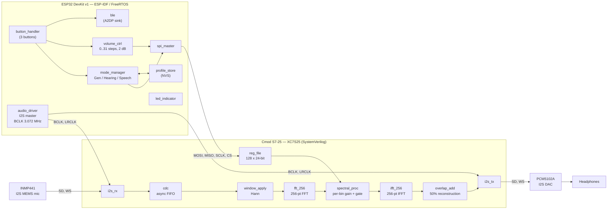

# Project Auris

**FPGA-Accelerated Assistive Audio Platform**

[](https://github.com/<OWNER>/project-auris/actions/workflows/ci.yml)
[](https://github.com/<OWNER>/project-auris/tree/main/docs)
[](./LICENSE)
[](https://github.com/<OWNER>/project-auris/releases)

Project Auris is an open-source hearing-assistive platform that pairs an
ESP32 microcontroller with a Xilinx Spartan-7 FPGA (Cmod S7-25) to perform
real-time spectral audio processing in a wearable form factor. An INMP441
MEMS microphone feeds a 256-point FFT pipeline running on the FPGA, which
applies user-configurable per-bin gain, noise gating, and dynamic range
compression before reconstruction and playback through a PCM5102A DAC. The
ESP32 owns the control plane — Bluetooth input, physical buttons, profile
persistence, and low-level configuration of the FPGA register file over
SPI — and exposes three named listening modes: *General*, *Hearing*, and
*Speech*.

---

## Architecture Overview

The system is split into two cooperating processors. The **ESP32** is the
control plane: it generates the audio clocks, drives the user interface,
persists settings in NVS, and pushes configuration into the FPGA over SPI.
The **FPGA** is the signal-processing plane: it receives I2S audio,
performs a 256-point overlap-save FFT pipeline with per-bin gain and
gating, and transmits the processed audio back out over I2S.



The signal flow on the FPGA is
`I2S_RX -> CDC -> Hann window -> FFT-256 -> spectral_proc (gain + gate) -> IFFT-256 -> 50% overlap-add -> I2S_TX`.
The spectral processor reads its per-bin gain coefficients from the
register file, which the ESP32 writes via SPI Mode 0 at up to 10 MHz.

---

## Quick Start

### Prerequisites

- **Vivado 2024.1 or newer** — the WebPack / free edition is sufficient for
  the XC7S25 device on the Cmod S7-25
- **ESP-IDF v5.2 or newer** with the ESP32 toolchain set up and on `PATH`
- **Python 3.9 or newer** for the coefficient and profile generators
- **Git** for version control
- A **Cmod S7-25** board, an **ESP32 DevKit v1**, a micro-USB cable for
  each, and (from Phase 3 onward) an **INMP441** I2S microphone and a
  **PCM5102A** I2S DAC on a breadboard

### Build

The repository ships with a top-level Makefile that orchestrates the three
independent build flows. Run them in order:

```bash
# 1. Clone the repository
git clone https://github.com/<OWNER>/project-auris.git
cd project-auris

# 2. Generate the Hann window and default gain profile tables
make tools

# 3. Build the FPGA bitstream (outputs to fpga/vivado_workspace/...)
make fpga

# 4. Build the ESP32 firmware (outputs to firmware/build/...)
make esp

# Or run the whole pipeline in one shot
make all
```

### Flash and Run

```bash
# Program the FPGA via Vivado Hardware Manager, or use openFPGALoader:
openFPGALoader -b cmod_s7 fpga/vivado_workspace/auris_cmod.runs/impl_1/top.bit

# Flash the ESP32 (set ESP_PORT to your serial port)
# Linux:   make esp-flash ESP_PORT=/dev/ttyUSB0
# Windows: make esp-flash ESP_PORT=COM3
make esp-flash ESP_PORT=COM3

# Open the serial monitor at 115200 baud
make esp-monitor ESP_PORT=COM3
```

For day-to-day FPGA work, `vivado fpga/vivado_workspace/auris_cmod.xpr`
opens the GUI for interactive debug, waveform inspection, and
floorplanning. See [`docs/IMPLEMENTATION_PLAN.md`](docs/IMPLEMENTATION_PLAN.md)
for the full list of build and simulation targets.

---

## Repository Structure

| Path        | Purpose                                                                  | Key contents                                                                                                                                  |
|-------------|--------------------------------------------------------------------------|-----------------------------------------------------------------------------------------------------------------------------------------------|
| `fpga/`     | SystemVerilog RTL, testbenches, constraints, IP, and build scripts        | `rtl/`, `sim/`, `constraints/`, `ip/`, `scripts/`, `generated/`                                                                              |
| `firmware/` | ESP-IDF C firmware running on the ESP32, organised as reusable components | `main/`, `components/spi_master/`, `components/fpga_config/`, `components/mode_manager/`, `components/audio_driver/`, `components/profile_store/`, ... |
| `tools/`    | Python code generators and bitstream utilities                           | `win_gen/`, `profile_gen/`, `fft_gen/`, `bitstream_utils/`                                                                                   |
| `hardware/` | Schematics, bill of materials, mechanical and wiring notes                | `schematics/`, `bom/`, `mechanical/`                                                                                                          |
| `docs/`     | Architecture, phase reports, college-application portfolio material      | `IMPLEMENTATION_PLAN.md`, `architecture/`, `hardware/`, `phase_reports/`, `college_app/`                                                      |

See [`docs/IMPLEMENTATION_PLAN.md`](docs/IMPLEMENTATION_PLAN.md) for the
complete file-level index and the per-phase file map.

---

## Hardware

Cmod S7-25 (XC7S25) FPGA + ESP32 DevKit v1 + INMP441 I2S MEMS microphone
+ PCM5102A I2S DAC, wired point-to-point on a breadboard. Pin assignments,
timing constraints, and the I2S / SPI wiring diagram live in
[`docs/hardware/WIRING.md`](docs/hardware/WIRING.md); the canonical bill
of materials with part numbers, suppliers, and per-line cost is in
[`hardware/bom/bom.csv`](hardware/bom/bom.csv).

---

## Documentation

| Document                                              | Purpose                                                                       |
|-------------------------------------------------------|-------------------------------------------------------------------------------|
| [`docs/IMPLEMENTATION_PLAN.md`](docs/IMPLEMENTATION_PLAN.md) | Source of truth: repository layout, phased plan, build and tooling instructions |
| [`docs/architecture/`](docs/architecture/)            | Block diagrams, clock-domain analysis, data-flow notes                        |
| [`docs/hardware/`](docs/hardware/)                    | Pin maps, wiring diagram, mechanical notes                                    |
| [`docs/phase_reports/`](docs/phase_reports/)          | End-of-phase reflections and lessons learned                                  |
| [`docs/college_app/`](docs/college_app/)              | Essay topics, demo script, technical report, portfolio framing                |

---

## Project Status

The project is being developed in six phases, aligned with the
[implementation plan](docs/IMPLEMENTATION_PLAN.md#2-development-phases--milestones).

| Phase | Title                            | Status      |
|-------|----------------------------------|-------------|
| 0     | Toolchain setup                  | In progress |
| 1     | FPGA blink (MMCM sanity check)   | Not started |
| 2     | ESP32 to FPGA SPI link           | Not started |
| 3     | I2S audio passthrough            | Not started |
| 4     | MVP — 256-pt FFT DSP pipeline    | Not started |
| 5     | Modes, persistence, polish       | Not started |

Once Phase 4 lands, the device is considered "MVP-complete" and is
sufficient for college-application demo material; Phase 5 and beyond add
polish and optional features such as Bluetooth audio, telemetry, and
dynamic range compression.

---

## Contributing

Contributions are welcome. Please read
[`CONTRIBUTING.md`](CONTRIBUTING.md) for the developer workflow, the
Developer Certificate of Origin (DCO) sign-off procedure, the branch and
naming conventions, and the area ownership table before opening a pull
request.

---

## License

Project Auris is released under the [MIT License](LICENSE).

---

## Acknowledgments

This project builds on the work of many upstream communities and vendors:

- **Digilent** — for the Cmod S7-25 board, the XC7S25 reference designs,
  and the open documentation that makes low-cost FPGA prototyping
  possible
- **Espressif** — for the ESP32 toolchain, ESP-IDF, and the FreeRTOS
  kernel that the firmware is built on
- **InvenSense / TDK** — for the INMP441 I2S MEMS microphone and its
  application notes
- **Texas Instruments** — for the PCM5102A I2S DAC and its evaluation
  documentation
- **Xilinx / AMD** — for Vivado and the XFFT IP core that powers the
  256-point FFT pipeline
