# System Block Diagram

> **Project Auris** — FPGA-accelerated hearing-assistive device
> **Last updated:** 2026-08 (FPGA-only migration)
> **Status:** Authoritative — matches the RTL topology in
> `fpga/rtl/top.sv`. There is no ESP32, no host controller, and no
> SPI link in this build.

This document is the single-pane-of-glass view of Project Auris. It shows
every processing element from the microphone to the headphone, every
control path from the onboard push button to the gain table, and every
clock path from the 12 MHz onboard oscillator to the audio codec pins.

If you only read one architecture document, read this one.

---

## 1. High-Level Block Diagram (Mermaid)

The diagram below is rendered automatically by GitHub / VS Code's
Markdown preview. It uses `graph LR` (left-to-right) so that the audio
chain reads left-to-right on the page while the control and clocking
paths branch off vertically.

```mermaid
graph LR
    %% =========== External peripherals ===========
    MIC["INMP441<br/>MEMS Mic<br/>(I2S slave, mono, L-chan)"]
    DAC["PCM5102A<br/>I2S DAC<br/>(I2S slave, stereo)"]
    HP["Headphones<br/>3.5 mm jack"]
    BTN_EXT["Onboard Push Buttons<br/>BTN0 mode+  BTN1 mode-<br/>BTN2 vol+   BTN3 vol-"]
    RGB_EXT["RGB LED0<br/>mode colour"]

    %% =========== FPGA subsystem (sole processor) ===========
    subgraph FPGA["FPGA Arty S7-25 (XC7S25) — FPGA-only architecture"]
        MMCM["clk_gen<br/>12 MHz → 96 MHz MMCM<br/>+ frac ÷31.25 BCLK<br/>+ ÷64 LRCLK"]
        SM["Status Monitor<br/>1 Hz heartbeat + clip"]

        I2S_RX["I2S RX<br/>(slave, 24-bit,<br/>mono from L-chan)"]
        I2S_TX["I2S TX<br/>(slave, 24-bit, stereo out)"]
        BTND["Button Debounce<br/>(4 buttons, 20 ms)"]
        MODE_FSM["Mode FSM<br/>(2-bit, wraps)"]
        VOL_FSM["Volume FSM<br/>(5-bit, 0..31)"]
        MODE_CTRL["Mode Ctrl<br/>(per-mode gain tables)"]

        subgraph CDC["CDC Modules (xdc marked async)"]
            CDC_IDX["I2S to DSP<br/>Async FIFO x 2 (L, R)"]
            CDC_DXI["DSP to I2S<br/>Async FIFO x 2 (L, R)"]
        end

        subgraph PIPE["DSP Pipeline (96 MHz)"]
            INBUF["Input Buffer<br/>Ping-pong BRAM"]
            WIN["Window Apply<br/>Hann 256 (Q2.14)"]
            FFT["FFT 256-pt<br/>(Xilinx xfft)"]
            SPEC["Spectral Proc<br/>128-bin gain + gate"]
            IFFT["IFFT 256-pt<br/>(Xilinx xfft)"]
            OLA["Overlap-Add<br/>50% COLA"]
            VOL["Volume Ctrl<br/>(Q2.14 multiply)"]
            OUTBUF["Output Buffer<br/>Ping-pong BRAM"]
        end
    end

    %% =========== Clocking (FPGA is the I2S master) ===========
    MMCM -- "BCLK 3.072 MHz" --> MIC
    MMCM -- "LRCLK 48 kHz"  --> MIC
    MMCM -- "BCLK 3.072 MHz" --> DAC
    MMCM -- "LRCLK 48 kHz"  --> DAC
    MMCM -- "BCLK" --> I2S_RX
    MMCM -- "BCLK" --> I2S_TX

    %% =========== Audio path (left to right) ===========
    MIC -- "SD" --> I2S_RX
    I2S_RX --> CDC_IDX --> INBUF
    INBUF --> WIN --> FFT --> SPEC
    SPEC --> IFFT --> OLA --> VOL --> OUTBUF
    OUTBUF --> CDC_DXI --> I2S_TX
    I2S_TX -- "SD" --> DAC --> HP

    %% =========== Control path (pushbuttons → FPGA only) ===========
    BTN_EXT --> BTND
    BTND --> MODE_FSM
    BTND --> VOL_FSM
    MODE_FSM --> MODE_CTRL --> SPEC
    VOL_FSM --> VOL
    MODE_FSM --> RGB_EXT

    %% =========== Telemetry / status ===========
    MMCM --> PIPE
    SPEC --> SM
```



> **Reading the diagram.** Audio flows left-to-right through the FPGA.
> The FPGA is the sole processor — there is no external microcontroller,
> no SPI link, no host control plane. Onboard push buttons (BTN0–BTN3)
> are the only user input surface; mode and volume are managed inside
> the FPGA via inline FSMs (`top.sv`) plus the pre-loaded gain-table
> streamer (`mode_ctrl.sv`). Telemetry (peak levels, frame count, error
> flags) is visible on the onboard LEDs (STATUS0 heartbeat, STATUS2
> sticky clip) and not exported to any host.

## 2. ASCII Fallback (text-only)

The Mermaid diagram above is the canonical view. This ASCII rendering is
provided for terminal / email / log-line viewing where Mermaid cannot
render.

```
                       +----------------------------+
                       |        EXTERNAL            |
                       |                            |
                       |  BTN0..3    INMP441  PCM5102A |
                       |  buttons    MEMS Mic I2S DAC |
                       |     |          |        ^   |
                       +-----|----------|--------|---+
                             |          |        |
                             v          v        |
  +===================== FPGA : Arty S7-25 (FPGA-only) =====================+
  |                                                                       |
  |  +--------+  +-------+  +--------+  +-------+  +---------+  +-------+ |
  |  | I2S RX |->| CDC   |->| Input  |->|Window |->|  FFT    |->|Spectral||
  |  |        |  |I2S->DSP| |Buffer  |  |Hann   |  |  256-pt |  |  Proc ||
  |  +--------+  +-------+  +--------+  +-------+  +---------+  +---+---+ |
  |       ^                                clk_gen                       |
  |       | BCLK/LRCLK (FPGA-generated)       |                          |
  |       |                                   v                          |
  |       |           Mode FSM           +---------+  +---------+        |
  |       |          (BTN0/BTN1)          |  IFFT   |->| Overlap |        |
  |  +--------+        |                 |  256-pt |  |   Add   |        |
  |  | btn    |--+     v                 +---------+  +----+----+        |
  |  | debounce|  |  Mode Ctrl (per-mode gain table loader)               |
  |  +--------+  |     |                                       |   |      |
  |       |      |     +---------------------------------> Spectral Proc   |
  |       v      |                                                 |      |
  |   Vol FSM    |                                                 v      |
  |  (BTN2/BTN3) |     +---------+  +-------+  +---------+   +---------+  |
  |       |      +->|  Volume  |->| Output |->| CDC     |->| I2S TX |  |
  |       |         |  (Q2.14) |  |Buffer  |  |DSP->I2S |  |        |  |
  |       |         +---------+  +---------+  +---------+   +---+----+  |
  |       |                                            clk_gen  |       |
  |       +=====================================================|       |
  |                                                            BCLK/LRCLK|
  +============================================================+========+
                       |                                  |
                       v                                  v
                   +---+---+                          +---+---+
                   | INMP441 |                        |PCM5102A|
                   +-------+                          +-------+
```

> The arrows on the right-hand side of the FPGA connect `clk_gen`
> back to the `I2S_RX`, `I2S_TX`, `INMP441`, and `PCM5102A`: the
> FPGA is the I2S clock master. The pushbuttons are debounced into
> the DSP domain, then split into a 2-bit mode FSM (BTN0/BTN1) and a
> 5-bit volume FSM (BTN2/BTN3). The mode FSM drives the mode
> indicator RGB LED and triggers `mode_ctrl` to load a fresh gain
> table into the spectral processor's inactive BRAM bank.

## 3. Signal Flow Description

The architecture has two distinct signal paths: the audio path from
microphone to headphone, and the control path from the onboard push
buttons to the gain table. Each is described below.

### 3.1 Audio Path — Mic to Headphones

The audio path is the project's primary function. It is a
spectral-domain processing chain running entirely on the FPGA, with
sample-rate matching on both ends.  M28: the source is mono (INMP441
L-channel tied to GND); the I2S bus is stereo and the FPGA only
consumes the left channel, then re-emits the processed left channel
on both L and R of the outgoing stereo frame.

1. **INMP441 MEMS microphone** captures ambient sound. The mic is an
   I2S slave; it shifts out 24-bit PCM data on the falling edge of
   BCLK on the left channel (L/R pin tied to GND).
2. **FPGA `clk_gen` (clock master)** generates BCLK (`3.072 MHz =
   64 × f_s`) and LRCLK (`48 kHz`) on-board from the 12 MHz
   oscillator via an MMCM (96 MHz DSP clock) and a fractional
   divide-by-31.25 counter. The mic and the DAC are both slaved to
   these FPGA-supplied clocks.
3. **FPGA I2S RX** (`i2s_rx.sv`) deserializes the SD line into 24-bit
   left/right samples, registered on the BCLK domain.
4. **CDC I2S → DSP** (`cdc_i2s_to_dsp.sv`) is an asynchronous FIFO
   (one per channel — L, R) with Gray-coded pointers. It hands
   samples to the 96 MHz DSP domain and asserts a one-cycle
   `dsp_sample_valid` per LRCLK period.
5. **Input Buffer** (`input_buffer.sv`) accumulates 256 samples into
   ping-pong BRAM. While bank A is being filled, bank B is consumed
   by the FFT, and vice versa.
6. **Window Apply** (`window_apply.sv`) multiplies each sample by
   the pre-computed Hann coefficient for its index. Coefficients are
   in `window_rom.sv` and were generated by
   `tools/win_gen/gen_hann_coeffs.py`.
7. **FFT 256-pt** (`fft_256.sv`) is the Xilinx pipelined streaming
   FFT IP. It produces 256 complex frequency bins per frame in
   pipelined-block-floating-point (BFP) format.
8. **Spectral Processing** (`spectral/spectral_proc.sv`) multiplies
   each bin by the active per-bin gain (Q2.14, 128 bins covering
   bins 0..127) from the dual-port BRAM mode table and applies the
   noise gate (zero bin if magnitude falls below the configured
   threshold).
9. **IFFT 256-pt** (`ifft_256.sv`) is the inverse FFT, also from the
   Xilinx IP catalog. Its output is a 256-sample time-domain frame
   multiplied by Hann again (the synthesis window is cancelled at
   the OLA stage).
10. **Overlap-Add** (`overlap_add.sv`) reconstructs the output by
    summing the current frame with the previous frame's second half.
    The 50% overlap and Hann window satisfy the COLA condition, so
    each output sample is the sum of exactly two windowed
    contributions that together equal one.
11. **Volume Ctrl** (`dsp/volume_ctrl.sv`) applies the 5-bit master
    volume level (`0..31`, where `31 = 1.0× Q2.14`) as a single
    multiplier just before the output buffer. Wired directly to
    the `vol_q14 = level × (16384/31)` Q2.14 mapping.
12. **Output Buffer** (`output_buffer.sv`) is another ping-pong
    BRAM. The CDC DSP → I2S FIFO reads from it on each LRCLK falling
    edge.
13. **CDC DSP → I2S** (`cdc_dsp_to_i2s.sv`) is a second asynchronous
    FIFO with Gray-coded pointers (one per channel — L, R). It
    smooths the rate mismatch between the bursty DSP output and the
    fixed 48 kHz I2S consumption.
14. **FPGA I2S TX** (`i2s_tx.sv`) serializes the samples onto the
    DAC's SD line, clocked by the FPGA-supplied BCLK.
15. **PCM5102A DAC** converts the digital stream to analog and
    drives the headphones.

### 3.2 Control Path — Onboard Push Buttons to Gain Table

The control path is fully self-contained inside the FPGA — there is
no SPI slave, no register file, and no host-controller dependency.
The four onboard push buttons (debounced in RTL) drive two small
inline FSMs in `top.sv`; mode changes trigger `mode_ctrl` to reload
the active gain table.

1. **User input** — the user presses one of the four onboard push
   buttons:
   - `BTN0` — mode increment
   - `BTN1` — mode decrement
   - `BTN2` — volume up (saturates at 31 = unity)
   - `BTN3` — volume down (saturates at 0 = mute)
2. **`btn_debounce.sv`** filters 20 ms of contact bounce and
   produces per-button press / release pulses.
3. **Mode FSM** (inline in `top.sv`) maintains a 2-bit `current_mode`
   (wraps 0 → 1 → 2 → 3 → 0 on increment, wraps in reverse on
   decrement). On every transition it asserts a 1-cycle
   `mode_we_pulse`.
4. **Volume FSM** (inline in `top.sv`) maintains a 5-bit
   `volume_level` with saturation at the extremes.
5. **`mode_ctrl`** (`fpga/rtl/ctrl/mode_ctrl.sv`) detects the
   `mode_we_pulse` and streams 128 Q2.14 coefficients for the
   newly-selected mode into the inactive bank of the spectral
   processor's dual-port BRAM, then asserts `bank_commit_o` to swap
   banks atomically. No audible click is produced even while audio
   is mid-frame, because every coefficient is in the BRAM before
   the swap and the spectral processor sees a stable table on both
   sides of the commit edge.
6. **Mode indicator** (RGB LED0): the `current_mode` value drives
   a small combinational decoder that sets the LED colour: green
   for mode 0, blue for mode 1, magenta for mode 2, red for mode 3
   (active-low drive on the Arty S7-25).
7. **Status / clip LEDs**: `status_mon.sv` generates a 1 Hz
   heartbeat on STATUS0 and a sticky clip-event latch on STATUS2.
   The clip latch can only be cleared by an FPGA reset (no host
   to clear it). Telemetry (peak levels, frame count, error flags)
   is computed inside the DSP pipeline but not exported — it is
   only observable via the LEDs and via simulation.

### 3.3 Bypass Path — DSP Disabled

When `dsp_enable_i = 0`, the pipeline is fully bypassed inside
`dsp_pipeline.sv`: input samples pass directly to the output
(registered, 1 cycle delay). The pipeline continues to run
internally but its output is ignored. This is useful for validating
the I2S chain independent of the DSP. In the FPGA-only build,
`dsp_enable_i` is hardwired to `1'b1` in `top.sv`; the bypass is
exercised only via simulation for diagnostic purposes.

---

## 4. Where to Read Next

- The DSP math, fixed-point formats, and per-stage latency live in
  [`dsp_pipeline.md`](dsp_pipeline.md).
- The 4 listening modes (General / Speech / Music / Hearing), their
  per-bin gain tables, and the LED colour map are in
  [`modes_and_gains.md`](modes_and_gains.md).
- The two clock domains (CD_DSP and CD_I2S) and their crossings are
  in [`clock_domains.md`](clock_domains.md).
- The historical register map (for the now-removed SPI host interface)
  is preserved in [`register_map.md`](register_map.md) as a
  reference.
- The FPGA resource budget (LUTs, BRAM, DSP48) is in
  [`resource_budget.md`](resource_budget.md).
