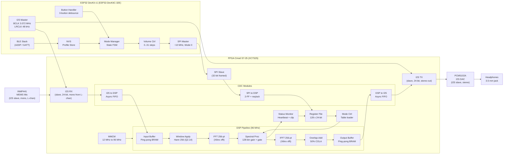

# System Block Diagram

> **Project Auris** — FPGA-accelerated hearing-assistive device
> **Last updated:** 2026-07
> **Status:** Authoritative — matches the RTL topology in `fpga/rtl/top.sv`
> and the firmware dependency graph in `firmware/main/main.c`.

This document is the single-pane-of-glass view of Project Auris. It shows
every processing element from the microphone element to the headphone
element, every control path from the button to the gain table, and every
telemetry path from the DSP pipeline back to the host controller.

If you only read one architecture document, read this one.

---

## 1. High-Level Block Diagram (Mermaid)

The diagram below is rendered automatically by GitHub / VS Code's
Markdown preview. It uses `graph LR` (left-to-right) so that the audio
chain reads top-to-bottom on the page while the data-flow direction
reads left-to-right.



> **Reading the diagram.** Audio flows left-to-right through the FPGA.
> Control flows top-to-bottom on the ESP32, then crosses to the FPGA via
> the SPI link. Telemetry flows back from the DSP pipeline to the register
> file, ready to be read by the ESP32's `telemetry` task.

---

## 2. ASCII Fallback (text-only)

The Mermaid diagram above is the canonical view. This ASCII rendering is
provided for terminal / email / log-line viewing where Mermaid cannot
render.

```
                            +----------------------------+
                            |        EXTERNAL            |
                            |                            |
                            |  INMP441       PCM5102A    |
                            |  MEMS Mic      I2S DAC     |
                            |     |              ^        |
                            +-----|--------------|--------+
                                  |              |
                                  v              |
  +=========================== FPGA : Cmod S7-25 ==========================+
  |  +--------+  +-------+  +--------+  +-------+  +---------+  +-------+ |
  |  | I2S RX |->| CDC   |->| Input  |->|Window |->|  FFT    |->|Spectral||
  |  |        |  |I2S->DSP| |Buffer  |  |Hann   |  |  256-pt |  |  Proc ||
  |  +--------+  +-------+  +--------+  +-------+  +---------+  +---+---+ |
  |       ^                                       |               |     |
  |       | BCLK/LRCLK (3.072 MHz)                v               v     |
  |       |                                   +---------+  +---------+  |
  |       |                                   |  IFFT   |->| Overlap |  |
  |       |                                   |  256-pt |  |   Add   | |
  |       |                                   +---------+  +----+----+  |
  |       |                                                  |    |     |
  |       v                                                  v    v     |
  |  +--------+  +-------+  +---------+  +--------+    +---------+     |
  |  | I2S TX |<-| CDC   |<-| Output  |<-| Status |    | Register|     |
  |  |        |  |DSP->I2S| |Buffer  |  | Monitor |    |  File   |     |
  |  +--------+  +-------+  +---------+  +--------+    | 128x24  |     |
  |       ^                                            +----+----+     |
  |       |                                                 ^          |
  |       |                                                 | SPI      |
  |       |                                            +----+----+     |
  |       |  BCLK/LRCLK (3.072 MHz)                    |   SPI   |     |
  |       +============================================|  Slave  |     |
  |                                                    +----+----+     |
  +=====================================================      |        |
                                                              v        |
                                                     +========================+
                                                     |       ESP32             |
                                                     |  (DevKit v1)            |
                                                     |                         |
                                                     |  +-------+  +-------+   |
                                                     |  | I2S   |  | SPI   |   |
                                                     |  | Master|  | Master|   |
                                                     +==|BCLK/  |==|  ~10  |===+
                                                        |LRCLK  |  |  MHz  |
                                                        +-------+  +-------+
                                                            ^           ^
                                                            |           |
                                                       +----+---+  +----+---+
                                                       | BTN /  |  | NVS    |
                                                       | BLE    |  | Profile|
                                                       +--------+  +--------+
```

---

## 3. Signal Flow Description

The architecture has three distinct signal paths. Each is described in
the subsections below.

### 3.1 Audio Path — Mic to Headphones

The audio path is the project's primary function. It is a
spectral-domain processing chain running on the FPGA, with sample-rate
matching on both ends.  M28: the source is mono (INMP441 L-channel
tied to GND); the I2S bus is stereo and the FPGA only consumes the
left channel, then re-emits the processed left channel on both L and
R of the outgoing stereo frame.

1. **INMP441 MEMS microphone** captures ambient sound. The mic is an I2S
   slave; it shifts out 24-bit PCM data on the falling edge of BCLK
   on the left channel (L/R pin tied to GND).
2. **ESP32 I2S master** generates the bit clock (BCLK = 3.072 MHz,
   64 × f_s) and word-select (LRCLK = 48 kHz). The mic and the DAC are
   both slaved to these clocks.
3. **FPGA I2S RX** (`i2s_rx.sv`) deserializes the SDIN line into 24-bit
   left/right samples, registered on the BCLK domain.
4. **CDC I2S → DSP** (`cdc_i2s_to_dsp.sv`) is an asynchronous FIFO with
   Gray-coded pointers. It hands samples to the 96 MHz DSP domain and
   asserts a one-cycle `dsp_sample_valid` per LRCLK period.
5. **Input Buffer** (`input_buffer.sv`) accumulates 256 samples into
   ping-pong BRAM. While bank A is being filled, bank B is consumed by
   the FFT, and vice versa.
6. **Window Apply** (`window_apply.sv`) multiplies each sample by the
   pre-computed Hann coefficient for its index. Coefficients are in
   `window_rom.sv` and were generated by `tools/win_gen/gen_hann_coeffs.py`.
7. **FFT 256-pt** (`fft_256.sv`) is the Xilinx pipelined streaming FFT
   IP. It produces 256 complex frequency bins per frame in
   pipelined-block-floating-point (BFP) format.
8. **Spectral Processing** (`spectral/spectral_proc.sv`) multiplies
   each bin by the active per-bin gain (Q2.14, 128 bins covering
   bins 0..127) and applies the noise gate (zero bin if magnitude
   falls below the configured threshold).
9. **IFFT 256-pt** (`ifft_256.sv`) is the inverse FFT, also from the
   Xilinx IP catalog. Its output is a 256-sample time-domain frame
   multiplied by Hann again (the synthesis window is cancelled at
   the OLA stage).
10. **Overlap-Add** (`overlap_add.sv`) reconstructs the output by
    summing the current frame with the previous frame's second half.
    The 50% overlap and Hann window satisfy the COLA condition, so
    each output sample is the sum of exactly two windowed contributions
    that together equal one.
11. **Output Buffer** (`output_buffer.sv`) is another ping-pong BRAM.
    The CDC DSP → I2S FIFO reads from it on each LRCLK falling edge.
12. **FPGA I2S TX** (`i2s_tx.sv`) serializes the samples onto the
    DAC's SDIN line.
13. **PCM5102A DAC** converts the digital stream to analog and
    drives the headphones.

### 3.2 Control Path — ESP32 to FPGA

The control path configures the FPGA in response to user input and
remote BLE commands.

1. **User input** — the user presses a button (mode, volume up, volume
   down) or sends a BLE GATT write.
2. **Mode Manager** (`mode_manager.c`) updates its internal state
   machine, producing a target mode (General / Hearing / Speech / Bypass)
   and volume step.
3. **Profile Store** (`profile_store.c`) looks up the 128-bin gain
   table associated with the current mode from NVS flash. If the user
   has never customised a profile, the default tables generated by
   `tools/profile_gen/gen_default_tables.py` are used.
4. **SPI Master** (`spi_master.c`) writes the new mode, volume, and
   (if needed) gain table entries to the FPGA register file. SPI
   runs at ~10 MHz, mode 0, MSB-first. See `register_map.md` for
   the exact protocol.
5. **FPGA SPI Slave** (`spi_slave.sv`) decodes the 32-bit framed
   command, latches the address and data, and asserts the write strobe.
6. **CDC SPI → DSP** (`cdc_spi_to_dsp.sv`) is a request/acknowledge
   handshake: 2-FF synchronizer on the data, dedicated request and
   acknowledge flip-flops with meta-stability hardening.
7. **Register File** (`reg_file.sv`) stores the new values and
   broadcasts the relevant fields (mode, master gain, gain table
   writes) to the appropriate consumers in the DSP domain.
8. **Mode Ctrl** (`mode_ctrl.sv`) detects the mode write and loads
   the mode's default 128-bin gain table into the inactive bank
   of the spectral processor. The ESP32 can then fine-tune individual
   bins via per-bin writes to the active bank.

### 3.3 Telemetry Path — FPGA to ESP32

The telemetry path gives the host visibility into the DSP pipeline.

1. **Spectral Proc** (`spectral_proc.sv`) reports its current peak
   input and peak output magnitudes to the register file at the
   end of every frame, and increments a 32-bit frame counter.
2. **Register File** latches the peak values and the frame counter
   into the read-only status registers (`REG_PEAK_LEVEL`, `REG_OUT_PEAK`,
   `REG_FRAME_COUNT_L/H`, `REG_ERROR_FLAGS`).
3. **Status Monitor** (`status_mon.sv`) generates a 1 Hz heartbeat
   output and a sticky clip-event latch; both are exposed on
   `status_led_o` and `status_clip_o` and copied into the status
   register field.
4. **ESP32 Telemetry Task** (`telemetry.c`, see `firmware_arch.md`)
   periodically (1 Hz) issues SPI reads to the status registers and
   forwards the values to `monitor_task`. If peak output exceeds
   0x700000 (about –3 dBFS), the LED indicator is updated to flash
   yellow as a clip warning.

---

## 4. Where to Read Next

- The DSP math, fixed-point formats, and per-stage latency live in
  [`dsp_pipeline.md`](dsp_pipeline.md).
- The 128-entry register file and the SPI protocol are in
  [`register_map.md`](register_map.md).
- The four clock domains and their crossings are in
  [`clock_domains.md`](clock_domains.md).
- The ESP32 software architecture (tasks, state machine, IPC) is in
  [`firmware_arch.md`](firmware_arch.md).
- The FPGA resource budget (LUTs, BRAM, DSP48) is in
  [`resource_budget.md`](resource_budget.md).
