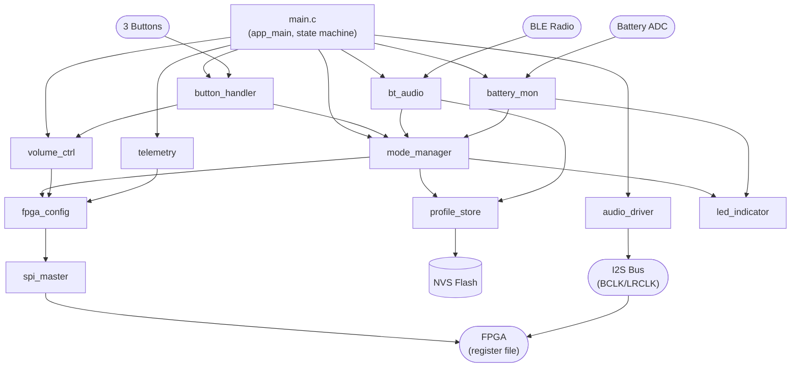
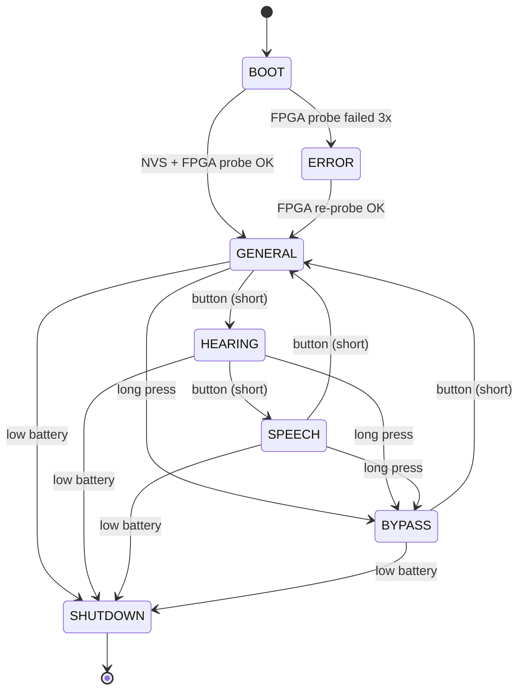

# ESP32 Firmware Architecture

> **Project Auris** — ESP32-DevKitC-32E firmware running ESP-IDF + FreeRTOS
> **Last updated:** 2026-07
> **Status:** Authoritative for the architectural intent. The
> implementation lives in `firmware/main/main.c` (top-level + 8 tasks)
> and the 11 components under `firmware/components/`.

The ESP32 is the user-facing half of Project Auris. It owns the
physical user interface (buttons, LED, battery), the Bluetooth
radio, the NVS flash profile store, and the I2S master clock
generator. It configures the FPGA by writing to the register file
over SPI; the FPGA in turn reports its status (peak levels, frame
counter, error flags) back over the same SPI link.

This document is the architectural companion to the firmware
source. It describes the eleven components, the eight FreeRTOS
tasks, the mode state machine, the SPI protocol, the NVS storage
layout, and the BLE GATT interface.

---

## 1. Component Diagram

The diagram below shows the eleven firmware components and their
inter-component dependencies. The arrows point from caller to
callee (i.e., `mode_manager` → `fpga_config` means mode_manager
calls into fpga_config).

### 1.1 Component responsibilities

| Component           | Header                              | Responsibility                                                                                       |
|---------------------|-------------------------------------|------------------------------------------------------------------------------------------------------|
| `main`              | `main/main.c`                       | Top-level entry point. Owns the device state machine, the global event group, and the IPC queues.    |
| `mode_manager`      | `components/mode_manager/`          | Mode state machine (General / Hearing / Speech / Bypass). Maps modes to default gain tables.        |
| `button_handler`    | `components/button_handler/`        | 3-button GPIO debounce. Detects short-press and long-press. Emits `button_event_t` to a queue.       |
| `volume_ctrl`       | `components/volume_ctrl/`           | Master volume control, 0..31 steps, 2 dB per step. Persists to NVS via `profile_store`.             |
| `fpga_config`       | `components/fpga_config/`           | High-level FPGA register API. Translates mode/volume/profile into SPI writes.                       |
| `spi_master`        | `components/spi_master/`            | Low-level SPI driver. Single transaction at a time; all callers serialise through the `spi_task`.    |
| `audio_driver`      | `components/audio_driver/`          | I2S master init. Generates BCLK (3.072 MHz) and LRCLK (48 kHz). Hands DMA buffers to `audio_task`.  |
| `bt_audio`          | `components/bt_audio/`              | Bluetooth A2DP sink + GATT server. Phase 3 — currently a stub that init/teardown only.              |
| `profile_store`     | `components/profile_store/`         | NVS persistence. 3 default profiles + 1 user-customisable profile per mode. Coalesces writes.       |
| `led_indicator`     | `components/led_indicator/`         | RGB LED pattern engine. Mode colour, boot, low-battery, peak-warning, error patterns.                |
| `battery_mon`       | `components/battery_mon/`           | Battery voltage ADC sampling, low/critical thresholds, and event-group signalling.                   |
| `telemetry`         | `components/telemetry/`             | 1 Hz polling of FPGA status registers. Forwards peak levels and error flags to other components.     |

---

## 2. FreeRTOS Task Layout

The firmware uses **8 FreeRTOS tasks**, pinned to the two ESP32
cores, communicating through 4 IPC queues and 1 event group. The
layout is:

| Task # | Name            | Priority | Stack (words) | Core | Responsibility                                                                  |
|--------|-----------------|----------|---------------|------|---------------------------------------------------------------------------------|
| 1      | `audio_task`    | 20       | 4096          | 1    | I2S zero-copy loopback. Highest priority; any stall here causes an audible glitch. |
| 2      | `button_task`   | 5        | 2048          | 0    | 10 ms debounce tick; emits `button_event_t` to `g_button_q`.                    |
| 3      | `mode_task`     | 4        | 3072          | 0    | Consumes `button_q` events; updates mode/volume state; dispatches SPI writes.   |
| 4      | `spi_task`      | 6        | 2048          | 0    | Serialises all SPI access via `g_spi_q`. Request/response via task notification. |
| 5      | `monitor_task`  | 3        | 3072          | 0    | 200 ms tick. Polls telemetry, samples battery, drives LED patterns on faults.    |
| 6      | `led_task`      | 2        | 2048          | 0    | 20 ms tick. Pattern engine for the RGB LED.                                     |
| 7      | `profile_task`  | 1        | 3072          | 0    | Coalesces NVS writes with a 500 ms debounce to minimise flash wear.             |
| 8      | `idle_feed_task`| 0        | 1024          | 1    | Feeds the task watchdog at 1 Hz on core 1 (the `audio_task` feeds itself).      |

### 2.1 IPC primitives

| Primitive             | Type            | Producer            | Consumer           | Payload                            |
|-----------------------|-----------------|---------------------|--------------------|------------------------------------|
| `g_event_group`       | EventGroup      | many                | many               | bit flags (FPGA connected, audio running, low battery, error, mode/volume changed) |
| `g_button_q`          | Queue (8)       | `button_task`       | `mode_task`        | `button_event_t`                   |
| `g_spi_q`             | Queue (8)       | `mode_task`, `monitor_task` | `spi_task` | `auris_spi_request_t` (read/write/bulk) |
| `g_led_q`             | Queue (4)       | `mode_task`, `monitor_task` | `led_task` | `auris_led_command_t` (set pattern / blink N / peak / off) |
| `g_profile_q`         | Queue (4)       | `mode_task`, `volume_ctrl` | `profile_task` | `auris_profile_save_request_t` (mode / volume / gain table / error) |
| Task notification     | xTaskNotifyGive | `spi_task`          | caller (e.g. `mode_task`) | notif. value carries the SPI result |

The `g_spi_q` queue is the only path to the FPGA's register file.
Every other component that needs to touch the FPGA goes through
`fpga_config` → `spi_master`, which posts a request to `g_spi_q`.
The `spi_task` consumes requests, executes the SPI transaction,
and notifies the original requester via `xTaskNotifyGive`. This
serialises SPI access and avoids bus contention from multiple
FreeRTOS tasks.

### 2.2 Why core 1 for audio?

The audio DMA engine on the ESP32 lives on the peripheral bus,
which is most efficiently accessed from core 1. Pinning
`audio_task` and `idle_feed_task` to core 1 keeps all audio work
on the same core, while everything else (mode, button, SPI,
telemetry, profile) lives on core 0. This split lets the I2S DMA
interrupts preempt control work without starving it.

---

## 3. State Machine

The device-level state machine lives in `main.c` (`auris_app_state_t`,
`auris_app_state_set`). It is **separate** from the `mode_manager`
state machine: the device state machine tracks the *runtime
health* of the system (booting, running, error, sleep), while
the mode manager tracks the *user-selected operating mode*
(General, Hearing, Speech, Bypass).

### 3.1 State transitions

| From      | To          | Trigger                                | Side effect                                                  |
|-----------|-------------|----------------------------------------|--------------------------------------------------------------|
| (boot)    | `BOOT`      | `app_main` start                       | NVS init, FPGA probe initiated.                              |
| `BOOT`    | `GENERAL`   | FPGA `REG_VERSION` reads non-zero      | Initial config pushed: `REG_MODE=GENERAL`, `REG_VOLUME=0x400000` (Q2.14 unity), `REG_MASTER_GAIN=0x400000` (Q2.14 unity). |
| `BOOT`    | `ERROR`     | FPGA probe failed 3×                   | LED pattern = ERROR; `monitor_task` keeps retrying.          |
| `GENERAL` | `HEARING`   | short button press                     | `REG_MODE` = HEARING; mode_ctrl loads Hearing gain table.   |
| `HEARING` | `SPEECH`    | short button press                     | `REG_MODE` = SPEECH; mode_ctrl loads Speech gain table.     |
| `SPEECH`  | `GENERAL`   | short button press                     | `REG_MODE` = GENERAL; mode_ctrl loads General gain table.   |
| any       | `BYPASS`    | button long-press (≥ 2 s)              | `REG_MODE` = BYPASS; `REG_CONTROL.bypass` (bit 1) = 1.      |
| `BYPASS`  | `GENERAL`   | short button press                     | `REG_MODE` = GENERAL; `REG_CONTROL.bypass` (bit 1) = 0.      |
| any       | `SHUTDOWN`  | battery critical                       | I2S stop, `audio_task` suspended, LED off.                   |
| `ERROR`   | `GENERAL`   | FPGA re-probe succeeds                 | resume normal operation.                                     |
| (3× err)  | (restart)   | 3 consecutive ERROR entries            | `esp_restart()` after 1 s.                                   |

### 3.2 LED feedback

The RGB LED colour reflects the current mode (visible at a glance,
no console required):

| Mode       | LED colour | Active-low drive (R, G, B) |
|------------|------------|----------------------------|
| `GENERAL`  | green      | (1, 0, 1)                  |
| `HEARING`  | blue       | (1, 1, 0)                  |
| `SPEECH`   | cyan       | (1, 0, 0)                  |
| `BYPASS`   | red        | (0, 1, 1)                  |
| `BOOT`     | white      | (0, 0, 0)                  |
| `ERROR`    | red flash  | toggle (0, 1, 1) at 2 Hz   |
| `SHUTDOWN` | off        | (1, 1, 1)                  |

The mode colour is also driven by the FPGA's RGB LED
(`led_rgb_r/g/b` in `top.sv`), which mirrors the ESP32's LED so the
user sees the same colour whether they look at the FPGA or the
ESP32 board.

---

## 4. SPI Communication

The ESP32 communicates with the FPGA over a 4-wire SPI link
(SCLK, MOSI, MISO, CS_N) on Pmod JA. The full protocol — frame
format, command bytes, register map — is in
[`register_map.md`](register_map.md). This section covers the
firmware-side details.

### 4.1 Configuration

| Parameter        | Value                                |
|------------------|--------------------------------------|
| Mode             | SPI Mode 0 (CPOL=0, CPHA=0)          |
| Bit order        | MSB first                            |
| Max clock        | 10 MHz (FPGA is the bottleneck)      |
| Word size        | 32 bits per transaction              |
| Slave select     | Active low, PULLUP on the FPGA side  |
| DMA              | Disabled (transactional, not streamed)|

### 4.2 Transaction lifecycle

1. **Caller** (e.g., `mode_task`) constructs an
   `auris_spi_request_t` with the request kind (`READ` / `WRITE` /
   `BULK`), address, data, and its own task handle.
2. **Caller** posts the request to `g_spi_q` with a 200 ms timeout.
3. **Caller** blocks on `ulTaskNotifyTake(pdTRUE, 200ms)`.
4. **`spi_task`** consumes the request from `g_spi_q`, executes
   the SPI transaction via `spi_master.c`, and on completion
   calls `xTaskNotifyGive(caller)`.
5. **Caller** wakes from the notification and reads the result
   (for `READ` requests) or simply continues (for `WRITE`).

This request/response pattern over a single-slot queue
semantically gives the caller exclusive, atomic access to the
FPGA register file. There is no risk of two tasks racing on the
SPI bus.

### 4.3 Error handling

| Failure mode             | Detection                          | Recovery                                              |
|--------------------------|------------------------------------|-------------------------------------------------------|
| SPI queue full           | `xQueueSend` returns `pdFALSE`     | Caller logs and skips the write; UI takes no action.  |
| SPI timeout (200 ms)     | `ulTaskNotifyTake` returns 0       | Caller logs, increments err_cnt; if err_cnt ≥ 3, `app_state = ERROR`. |
| Bad `REG_VERSION`        | read returns `0x000000` or `0xFFFFFF` | FPGA not ready; `app_state = BOOT` (retry).         |
| FPGA stalls (frame count frozen) | `monitor_task` 2 s no-progress check | `app_state = ERROR`.                            |

---

## 5. NVS Storage

`profile_store` persists the following keys in the NVS
namespace `auris`:

| Key              | Type    | Size      | Description                                                  |
|------------------|---------|-----------|--------------------------------------------------------------|
| `boot_cnt`       | u32     | 4 B       | Number of times the firmware has booted. Incremented on every `nvs_flash_init`. |
| `err_cnt`        | u8      | 1 B       | Number of consecutive errors. Reset to 0 on successful boot. ≥ 3 triggers a factory reset. |
| `mode`           | u8      | 1 B       | Last selected mode (0..3). Defaults to 0 (General).          |
| `volume`         | u8      | 1 B       | Last selected volume step (0..31). Defaults to 16.           |
| `gain_general`   | blob    | 128 × 2 B = 256 B | Per-bin gain table for General mode. Q2.14 per bin.  |
| `gain_hearing`   | blob    | 256 B     | Per-bin gain table for Hearing mode.                         |
| `gain_speech`    | blob    | 256 B     | Per-bin gain table for Speech mode.                          |
| `gain_user`      | blob    | 256 B     | User-customisable gain table (overrides mode-specific).      |

**Total NVS footprint:** approximately **780 bytes** for all keys,
well within the default 20 KB NVS partition. The NVS partition
itself is defined in `firmware/partitions.csv` and is the default
4 MB app / 908 KB NVS layout.

### 5.1 Write coalescing

`profile_task` collects write requests for 500 ms before
committing, which keeps flash wear well below the rated endurance
of the SPI NOR (typically 100 k cycles per sector). Even a power-
user who hammers the volume buttons 10 times per second will not
exceed a few thousand NVS writes per day.

### 5.2 Default gain tables

The three default tables (General, Hearing, Speech) are generated
at build time by `tools/profile_gen/gen_default_tables.py` and
embedded in the firmware image as `const` arrays. They are also
written to NVS on the first boot of a device that has never been
configured.

---

## 6. BLE Interface

Bluetooth Low Energy is **Phase 3** work. The current stub
(`bt_audio.c`) initialises the controller and tears it down on
shutdown, but does not register a GATT server yet. The
*architectural intent* is:

### 6.1 GATT service

| Characteristic        | UUID (short) | Properties        | Description                                    |
|-----------------------|--------------|-------------------|------------------------------------------------|
| `auris_mode`          | `0x2A01`     | R + W + Notify    | Read/write current mode; notify on change.     |
| `auris_volume`        | `0x2A02`     | R + W + Notify    | Read/write volume step (0..31); notify on change. |
| `auris_gain_table`    | `0x2A03`     | R + W             | Read/write 128-bin gain table (256 bytes).      |
| `auris_battery`       | `0x2A04`     | R + Notify        | Read battery level (0..100 %); notify every 60 s. |
| `auris_status`        | `0x2A05`     | R + Notify        | Read peak input/output, error flags; notify on clip. |

### 6.2 A2DP audio

The `bt_audio` component will also accept an A2DP source stream
and forward it to the I2S TX path. The intended use case is
"phone plays music → ESP32 receives over A2DP → FPGA
processes → headphones". The DSP pipeline runs identically for
A2DP and microphone input; the ESP32's `audio_driver` is the
only component that needs to know the difference.

---

## 7. Where to Read Next

- The high-level system block diagram (showing the ESP32 and FPGA
  in context) is in [`block_diagram.md`](block_diagram.md).
- The SPI register map and protocol are in
  [`register_map.md`](register_map.md).
- The DSP pipeline that the ESP32 configures is in
  [`dsp_pipeline.md`](dsp_pipeline.md).
- The clock domains (specifically the SPI↔DSP crossing) are in
  [`clock_domains.md`](clock_domains.md).
- The FPGA-side register map and the indirect gain-table write
  protocol used in the current RTL revision are in
  [`fpga/rtl/pkg/auris_pkg.sv`](../../fpga/rtl/pkg/auris_pkg.sv).
- The NVS layout is in `firmware/partitions.csv` (the partition
  table) and in `firmware/components/profile_store/profile_store.c`
  (the key definitions).
