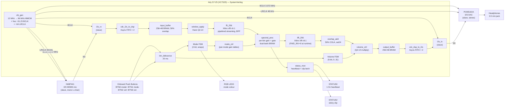

# FPGA-Only Architecture Overview

> **Project Auris** — Canonical architecture reference for the FPGA-only build. **Last updated:** 2026-08-12 (FPGA-only
> migration) **Status:** Authoritative. This document is the single-pane-of-glass overview of the current architecture.
> For deeper detail, follow the cross-links to `docs/architecture/*.md` and `docs/hardware/WIRING.md`.

This document supersedes all earlier "ESP32 + FPGA" architecture descriptions. The migration to a single-FPGA build was
completed on 2026-08-12 and removed the ESP32 microcontroller, the SPI control plane, the `reg_file`, the
`cdc_spi_to_dsp` / `cdc_dsp_to_spi` modules, and the `spi_slave` interface. The FPGA is now the sole signal-processing,
control, and I/O-master entity in the system.

If you only read one architecture document, read this one. Historical firmware and RTL are retained in
[`archive/`](../archive/) for reference.

---

## 1. Overview

Project Auris is a **single FPGA plus two audio codecs** — no external microcontroller, no host processor, no firmware
to flash. The **Digilent Arty S7-25** performs every function:

- **Signal processing.** A 256-point FFT-based spectral pipeline with per-bin gain, noise gating, and overlap-add
  reconstruction.
- **Control.** The four onboard push buttons (BTN0–BTN3) drive inline FSMs in `top.sv` for mode and volume; the onboard
  RGB LED indicates the active mode; status LEDs (STATUS0 heartbeat, STATUS2 clip event) surface pipeline health.
- **I/O master.** The FPGA generates BCLK (3.072 MHz) and LRCLK (48 kHz) on-board via `clk_gen.sv` and drives both the
  INMP441 MEMS microphone and the PCM5102A DAC. There is no external clock source.



---

## 2. Hardware

### 2.1 Board

| Item              | Value                                                |
| ----------------- | ---------------------------------------------------- |
| Board             | Digilent Arty S7-25 Rev. E                           |
| FPGA              | Xilinx Spartan-7 **XC7S25-1CSGA324C**                |
| Logic cells       | 23,360 (= 4 × 6-input LUTs)                          |
| Block RAM         | 1,620 Kb (45 × 36 Kb tiles)                          |
| DSP slices        | 80 × DSP48E1                                         |
| User I/O          | 150                                                  |
| Speed grade       | –1                                                   |
| Temperature grade | C (commercial, 0 °C–85 °C)                           |
| Process           | 28 nm                                                |
| Power             | USB Micro-B, 5 V in                                  |
| Programming       | Vivado Hardware Manager via USB, or `openFPGALoader` |

### 2.2 Audio codecs

| Item         | Manufacturer      | Function                         | Interface                                                       |
| ------------ | ----------------- | -------------------------------- | --------------------------------------------------------------- |
| **INMP441**  | TDK / InvenSense  | MEMS I²S microphone              | 24-bit, 48 kHz, mono L-channel; **slave** — clocked by the FPGA |
| **PCM5102A** | Texas Instruments | I²S audio DAC + headphone driver | 24-bit, 48 kHz, stereo; **slave** — clocked by the FPGA         |

Both codecs are wired point-to-point on a breadboard (or planned custom PCB). All interconnects are 3.3 V LVCMOS. The
FPGA drives BCLK and LRCLK to both codecs; the codecs never drive a clock back to the FPGA.

### 2.3 Push buttons (Arty S7-25 onboard)

The four onboard push buttons are active-low and have external pull-ups on the PCB. They are debounced in the FPGA by
`btn_debounce.sv` (20 ms, with press/release edge pulses).

| Button | Arty silkscreen   | FPGA pin (Pmod pin) | Function                     |
| ------ | ----------------- | ------------------- | ---------------------------- |
| BTN0   | D18 (Pmod JA[8])  | C12                 | Mode increment               |
| BTN1   | D19 (Pmod JA[9])  | C11                 | Mode decrement               |
| BTN2   | D20 (Pmod JA[10]) | F13                 | Volume up (saturates at 31)  |
| BTN3   | D21 (Pmod JA[11]) | E13                 | Volume down (saturates at 0) |

### 2.4 LEDs (Arty S7-25 onboard)

| LED                   | FPGA pin        | Function                                                           |
| --------------------- | --------------- | ------------------------------------------------------------------ |
| STATUS0 (LED[0])      | E18             | 1 Hz heartbeat — toggles when the FPGA is healthy and out of reset |
| STATUS2 (LED[2])      | G15             | Sticky clip-event indicator — cleared only by FPGA reset           |
| RGB LED 0 — R / G / B | J15 / G17 / F15 | Mode indicator (active-low on the Arty S7-25)                      |

The clip LED on the Digilent master XDC is LED[1] (F13), but F13 is shared with BTN2 in this build. To resolve the
conflict, the clip indicator is moved to LED[2] (G15) and F13 yields to BTN2. See `fpga/constraints/arty_s7_25.xdc` §3
and §5.

### 2.5 Power

A single USB Micro-B cable to the Arty S7-25 powers the entire system. The FPGA's onboard regulators produce the 3.3 V,
1.8 V, and 1.0 V rails. The INMP441 and PCM5102A are powered from the Arty's Pmod JA 3.3 V rail (pin 6). No ESP32, no
second USB cable, no battery in this build.

---

## 3. Clock Architecture

Two clock domains only. Both are generated inside the FPGA from the 12 MHz onboard oscillator. There is no external
clock input and no SPI clock domain.

| Domain   | Frequency                         | Source                                                                                                  | Used by                                                                                                                                        |
| -------- | --------------------------------- | ------------------------------------------------------------------------------------------------------- | ---------------------------------------------------------------------------------------------------------------------------------------------- |
| `CD_DSP` | **96 MHz**                        | MMCME2_BASE in `clk_gen.sv` (VCO at 600 MHz ÷ 6.25)                                                     | All DSP pipeline stages, `btn_debounce`, `mode_ctrl`, `volume_ctrl`, `status_mon`, inline mode/volume FSMs, DSP-side of the I2S↔DSP CDC FIFOs |
| `CD_I2S` | **3.072 MHz BCLK / 48 kHz LRCLK** | `clk_gen.sv` fractional divider: 96 MHz ÷ 31.25 (toggle pattern 31, 31, 31, 32) for BCLK; ÷64 for LRCLK | `i2s_rx`, `i2s_tx`, LRCLK 2-FF synchroniser, BCLK-side of the I2S↔DSP CDC FIFOs, Pmod JA BCLK + LRCLK output pins                             |

**Why two domains instead of three?** The SPI clock domain (CD_SPI) was removed when the ESP32 was removed. There is no
host interface, no register file, and no CDC handshake crossing a third clock. The only clock crossings in this build
are I2S↔DSP, both ways.

**Why mark the two groups as asynchronous in the XDC?** Even though the BCLK is technically derived from the DSP clock,
the two are treated as mutually asynchronous. The CDC FIFOs are explicitly designed to handle the crossing regardless of
phase. Marking the groups as asynchronous tells Vivado to skip inter-domain timing analysis and to trust the CDC
structures.

For the full clock-domain analysis (metastability mitigation, MTBF, constraint snippets), see
[`docs/architecture/clock_domains.md`](architecture/clock_domains.md).

---

## 4. DSP Pipeline

The signal path is fixed and runs entirely on the FPGA. There is no firmware at runtime; the FPGA is the entire audio
engine.

```text
INMP441 (I2S slave)
    |
    v
i2s_rx (BCD -> {left[23:0], right[23:0]}, valid_o pulse)
    |
    v
cdc_i2s_to_dsp x 2   (async FIFO, depth 4, Gray-coded pointers, 2-FF sync)
    |                  one FIFO per channel; 24-bit data
    v
input_buffer (256 x 48-bit true-dual-port BRAM, 50% overlap;
              128 new + 128 old samples per frame)
    |
    v
window_apply (256-tap Hann window, Q2.14 x Q2.14 -> Q2.14,
              real input only -- imaginary channel = 0)
    |
    v
fft_256 (Xilinx xfft v9.1 IP, 256-pt, pipelined streaming I/O,
          16-bit fixed-point, Block Floating Point output)
    |
    v
spectral_proc (4-stage pipeline:
              gain lookup -> master gain multiply -> |X|^2 -> gate + multiply;
              Q2.14 multiplies; 128-bin gain table in dual-bank BRAM)
    |
    v
ifft_256 (same IP, FWD_INV = 0 at runtime; BFP exponent output)
    |
    v
overlap_add (50% COLA, history buffer in BRAM,
             out = sat24((cur + hist) <<< (E_fft + E_ifft + 6)))
    |
    v
volume_ctrl (Q2.14 multiply, 31 levels; level 31 = unity, level 0 = mute;
             vol_q14 = level * (16384 / 31) ~ level * 529)
    |
    v
output_buffer (256 x 48-bit ping-pong BRAM, 128 samples per half)
    |
    v
cdc_dsp_to_i2s x 2   (async FIFO, depth 4)
    |                  one FIFO per channel
    v
i2s_tx (24-bit L/R serialiser; LRCLK falling-edge read strobe)
    |
    v
PCM5102A DAC (I2S slave) -> 3.5 mm headphones
```

For the per-stage math, latency budget, and resource estimate, see
[`docs/architecture/dsp_pipeline.md`](architecture/dsp_pipeline.md).

### 4.1 Bypass mode

When `dsp_enable_i = 0` (the default at bring-up), the entire DSP pipeline is bypassed. The CDC'd input samples
(`sample_l_i`, `sample_r_i`, `sample_valid_i`) are passed registered (1 cycle) directly to the output mux. The pipeline
keeps running internally but its output is ignored. Bypass is the cheapest way to validate the I2S ↔ CDC ↔ DAC
plumbing independent of any DSP question.

### 4.2 Pipeline latency

Algorithmic latency (input buffer fill + FFT/IFFT pipelining) is approximately **5.33 ms** (one frame period at 48 kHz).
End-to-end perceived latency (including INMP441 + PCM5102A codec pipeline delay, typically < 1 ms each) is on the order
of 7–8 ms, well below the 20 ms threshold for detecting audio delay in headphones.

---

## 5. User Input

### 5.1 Buttons

| Button | Function                                                               | Implementation                                                                      |
| ------ | ---------------------------------------------------------------------- | ----------------------------------------------------------------------------------- |
| BTN0   | Mode increment (cycles General → Speech → Music → Hearing → General …) | Inline `always_ff` in `top.sv`; unsigned 2-bit arithmetic gives natural wrap-around |
| BTN1   | Mode decrement (cycles in reverse)                                     | Same FSM; wraps 0 → 3                                                               |
| BTN2   | Volume up (saturates at 31 = unity)                                    | Inline `always_ff` in `top.sv`; level + 1 if level < 31                             |
| BTN3   | Volume down (saturates at 0 = mute)                                    | Inline `always_ff` in `top.sv`; level – 1 if level > 0                              |

All four buttons go through `btn_debounce.sv` (20 ms debounce, press and release pulse outputs) before reaching the
FSMs. The FSMs are clocked at 96 MHz in `CD_DSP`; they do not cross any clock domain.

### 5.2 Volume mapping

The 5-bit `volume_level` register is consumed by `dsp_pipeline.sv` and passed to `volume_ctrl.sv`. The mapping is linear
in Q2.14:

```text
vol_q14 = level * (16384 / 31)  ~=  level * 529
level  0  ->  0x0000   (mute)
level 16  ->  0x2108   (~51.6 % of unity)
level 31  ->  0x4000   (unity, 1.0x)
```

Volume is applied **after** overlap-add and **before** the output buffer, in the time domain. The multiply is a single
DSP48E1 operation (signed × unsigned Q2.14) with 24-bit saturation.

### 5.3 Mode control

The 2-bit `current_mode` register drives two things:

1. **`mode_ctrl.sv`** — loads the pre-computed per-mode gain table into the inactive bank of `spectral_proc`'s dual-port
   BRAM and pulses `bank_commit_o` to atomically swap banks. The swap is single-cycle; the audio path sees no gain
   glitch.
2. **RGB LED decode** — an inline `case` statement in `top.sv` drives the active-low RGB LED pins.

For the per-mode gain tables and LED colour mapping, see
[`docs/architecture/modes_and_gains.md`](architecture/modes_and_gains.md).

---

## 6. Mode System

### 6.1 Modes

| Mode ID | Name        | RGB LED colour | Use case                                                     |
| ------: | ----------- | -------------- | ------------------------------------------------------------ |
|       0 | **General** | Green          | Transparent passthrough; flat unity gain across all 128 bins |
|       1 | **Speech**  | Blue           | Vocal presence boost with high-shelf roll-off                |
|       2 | **Music**   | Magenta        | Flat mids with sub-bass lift and air/sparkle shelf           |
|       3 | **Hearing** | Red            | Ski-slope high-frequency emphasis for HF hearing loss        |

> **Mode numbering note.** The four modes are 0 = General, 1 = Speech, 2 = Music, 3 = Hearing. Earlier (pre-2026-08)
> documentation used a different numbering with Bypass at index 3 and no Music mode. The current numbering is the
> canonical one shipped inside `mode_ctrl.sv` and decoded by `top.sv`.

The mode is changed with BTN0 (increment) or BTN1 (decrement). Every mode change fires `mode_we_pulse` once, which
`mode_ctrl` uses to stream 128 Q2.14 coefficients into the inactive bank and then commit the swap.

### 6.2 Gain-table format

Each mode ships with a 128-entry Q2.14 gain table inside `mode_ctrl.sv` (constant data, inferred as distributed
LUT-ROM). The table is loaded into one of two BRAM banks inside `spectral_proc`; the other bank holds the
previously-active table. On commit, the active bank toggles atomically.

Hermitian symmetry: bins 0–127 are the unique spectral bins of a real-input 256-pt FFT; bins 128–255 are conjugates and
are written back automatically by `spectral_proc`. For real IFFT output, the gain table must satisfy
`gain[k] = gain[128 − k]` for k = 1..127. The pre-computed mode tables do enforce this.

---

## 7. Clock Domain Crossing

Two FIFO crossings, both audio (24-bit data per channel):

| #   | Source   | Destination | Method                                     | Depth                    |
| --- | -------- | ----------- | ------------------------------------------ | ------------------------ |
| 1   | `CD_I2S` | `CD_DSP`    | Async FIFO, Gray-coded pointers, 2-FF sync | 4 (one FIFO per channel) |
| 2   | `CD_DSP` | `CD_I2S`    | Async FIFO, Gray-coded pointers, 2-FF sync | 4 (one FIFO per channel) |

**Why no SPI CDC?** There is no SPI host in this build. Mode, volume, gain tables, and telemetry are entirely internal.

**Why 4-deep?** 48 kHz is far slower than 96 MHz, so the FIFOs stay near-empty (0–1 entries in steady state). Depth = 4
provides robust headroom for scheduler jitter without consuming a BRAM tile (the FIFOs are LUTRAM, ~70 LUTs each).

For the full CDC analysis (Gray coding, 2-FF synchroniser attribute, MTBF, Vivado constraint snippets), see
[`docs/architecture/clock_domains.md`](architecture/clock_domains.md).

---

## 8. Verification Strategy

The FPGA-only build focuses verification on the modules that changed during the migration:

- **`btn_debounce`** — edge detection, 20 ms debounce, both press and release pulses.
- **`volume_ctrl`** — Q2.14 multiply, 31 levels, sat24 at the output, mute at level 0.
- **`mode_ctrl`** — atomic dual-bank BRAM swap, per-mode table load (128 cycles), bank commit pulse.
- **`i2s_rx` / `i2s_tx`** — FPGA is now the I²S clock master, not slave. Timing relationships with the INMP441 and
  PCM5102A must be re-validated.

The pre-migration SPI / CDC-handshake testbenches (`tb_spi_slave.sv`, `tb_reg_file.sv`, `tb_cdc_spi_to_dsp.sv`,
`tb_cdc_dsp_to_spi.sv`) are removed from the build. The associated modules are removed from the RTL. CI script
`sim_all.tcl` auto-discovers the remaining testbenches; there is no need to delete the dead testbench files from the
source tree as part of this migration (they remain on disk but are not referenced by the build).

For the per-testbench audit, see [`verification_coverage_audit.md`](verification_coverage_audit.md).

---

## 9. Project Structure

```text
Project_Auris/
├── docs/                       # All architecture, hardware, migration docs
│   ├── architecture/           # block_diagram, dsp_pipeline, clock_domains,
│   │                           # modes_and_gains, resource_budget (current)
│   │                           # register_map, firmware_arch (historical)
│   ├── hardware/               # WIRING, BOM, README, schematics README
│   ├── fpga_only_architecture.md   # ← this file

│
├── fpga/                       # ALL synthesizable + simulation code lives here
│   ├── rtl/                    # SystemVerilog RTL
│   │   ├── top.sv              # Top-level wrapper (FPGA-only)
│   │   ├── clk_gen.sv          # 12 MHz -> 96 MHz MMCM + BCLK/LRCLK divider
│   │   ├── pkg/auris_pkg.sv    # Global types, parameters, constants
│   │   ├── io/                 # i2s_rx, i2s_tx, btn_debounce
│   │   ├── cdc/                # cdc_i2s_to_dsp, cdc_dsp_to_i2s
│   │   ├── ctrl/               # mode_ctrl, status_mon
│   │   └── dsp/                # input_buffer, window_apply, window_rom,
│   │                           #   fft_256, spectral_proc, ifft_256,
│   │                           #   overlap_add, output_buffer,
│   │                           #   dsp_pipeline, volume_ctrl
│   ├── sim/                    # Testbenches and simulation infrastructure
│   ├── constraints/            # arty_s7_25.xdc (FPGA-only pin map)
│   ├── scripts/                # Vivado Tcl (build + sim)
│   ├── ip/                     # Generated IP cores (xfft v9.1)
│   └── generated/              # Pre-generated artefacts (.hex, .coe)
│
├── archive/                    # HISTORICAL — ESP32 + SPI + reg_file source
│   ├── firmware/               # Archived ESP-IDF firmware tree
│   ├── rtl/                    # Archived spi_slave, cdc_spi_*, reg_file
│   └── tb/                     # Archived testbenches
│
├── firmware/                   # HISTORICAL — kept on disk per instructions;
│                               #   identical to archive/firmware/.
│                               #   Not part of the build.
│
├── hardware/                   # Physical design files
│   ├── schematics/             # Planned KiCad capture (FPGA-only)
│   ├── bom/                    # BOM (FPGA-only; no ESP32)
│   └── mechanical/             # Enclosure notes (FPGA-only)
│
├── tools/                      # Python tooling (FPGA-only)
│   ├── win_gen/                # Hann window coefficient generator
│   ├── fft_gen/                # FFT validation helpers (Xilinx xfft v9.1)
│   ├── profile_gen/            # Per-mode gain table generator
│   ├── freq_resp_gen/          # Frequency-response utilities
│   ├── test_vector_gen/        # Test-vector generators
│   ├── latency_analysis/       # Latency budget + measurement
│   ├── validation/             # COLA, Parseval, gain table checks
│   ├── config/                 # YAML configuration
│   └── common/                 # Shared constants, fixed-point, audiogram
│
├── .github/
│   ├── workflows/              # CI workflows (ci.yml, docs.yml, release.yml)
│   ├── ISSUE_TEMPLATE/         # Bug + feature templates (FPGA-only)
│   └── PULL_REQUEST_TEMPLATE.md
│
└── (root)
    ├── README.md               # Project front door
    ├── ENGINEERING_DESIGN.md   # Long-form design doc; ESP32-era sections
    │                           #   annotated as historical
    ├── CONTRIBUTING.md         # FPGA-only workflow
    ├── CHANGELOG.md            # FPGA-only migration entries
    ├── verification_coverage_audit.md
    ├── docs/fpga_only_architecture.md   # ← this file
```

### 9.1 What is _not_ in this build

- **No ESP32.** The breadboard has exactly one microcontroller-class device: the FPGA. No ESP32, no Wi-Fi, no Bluetooth,
  no USB-serial bridge, no NVS storage.
- **No SPI control plane.** No `spi_slave.sv`, no `reg_file.sv`, no `cdc_spi_to_dsp.sv`, no `cdc_dsp_to_spi.sv`. Mode
  and volume are driven by onboard push buttons through inline FSMs in `top.sv`.
- **No firmware at runtime.** Historical firmware is preserved under `archive/firmware/` but is not part of the build.
- **No external host controller.** There is no phone app, no BLE GATT server, no UART telemetry stream. Telemetry is
  visible on the onboard LEDs only (heartbeat + sticky clip).

---

## 10. Migration Note

The FPGA-only architecture is the active design. Historical ESP32 firmware and RTL are retained under [`archive/`](../archive/)
for reference and are not part of the FPGA build.

---

## 11. Where to Read Next

- [`docs/hardware/WIRING.md`](hardware/WIRING.md) — breadboard wiring guide for the FPGA-only build (no ESP32).
- [`docs/architecture/block_diagram.md`](architecture/block_diagram.md) — Mermaid + ASCII system block diagram
  (FPGA-only).
- [`docs/architecture/clock_domains.md`](architecture/clock_domains.md) — two-domain model, CDC FIFOs, metastability
  mitigation.
- [`docs/architecture/dsp_pipeline.md`](architecture/dsp_pipeline.md) — per-stage math, latency budget, data formats.
- [`docs/architecture/modes_and_gains.md`](architecture/modes_and_gains.md) — four listening modes, per-mode gain
  tables, LED colour map.
- [`docs/architecture/resource_budget.md`](architecture/resource_budget.md) — per-module LUT/FF/BRAM/DSP48 estimates
  (FPGA-only).
- [`docs/architecture/register_map.md`](architecture/register_map.md) — HISTORICAL — SPI register map (archived for
  reference only).
- [`docs/architecture/firmware_arch.md`](architecture/firmware_arch.md) — HISTORICAL — ESP32 firmware architecture
  (archived for reference only).
- [`fpga/constraints/arty_s7_25.xdc`](../fpga/constraints/arty_s7_25.xdc) — pin map and timing constraints
  (authoritative).
